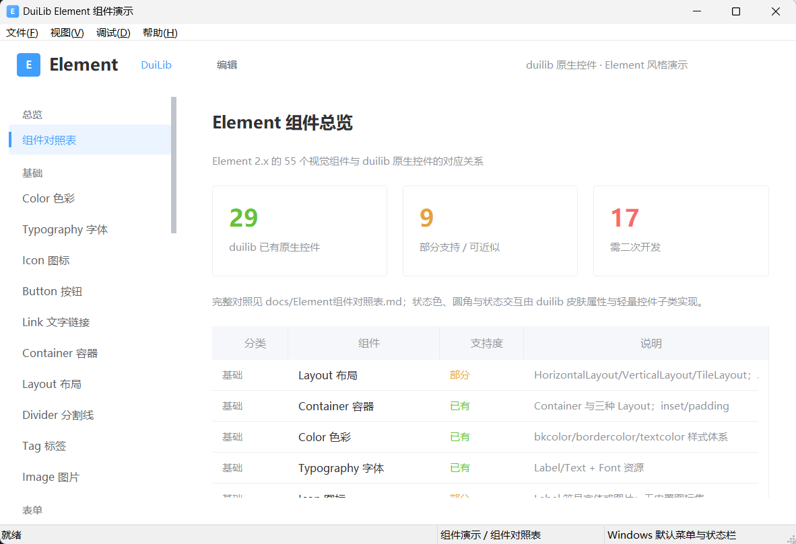
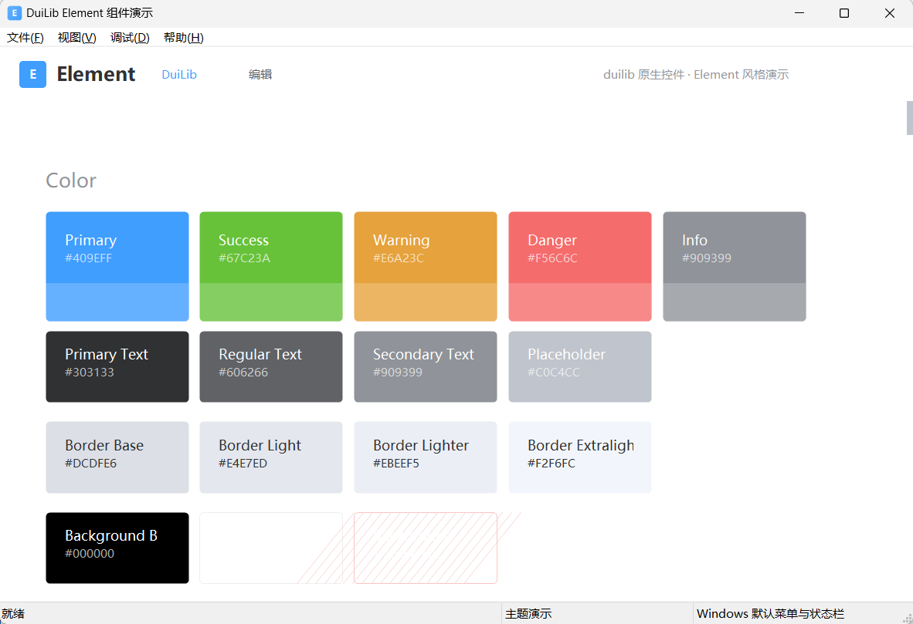
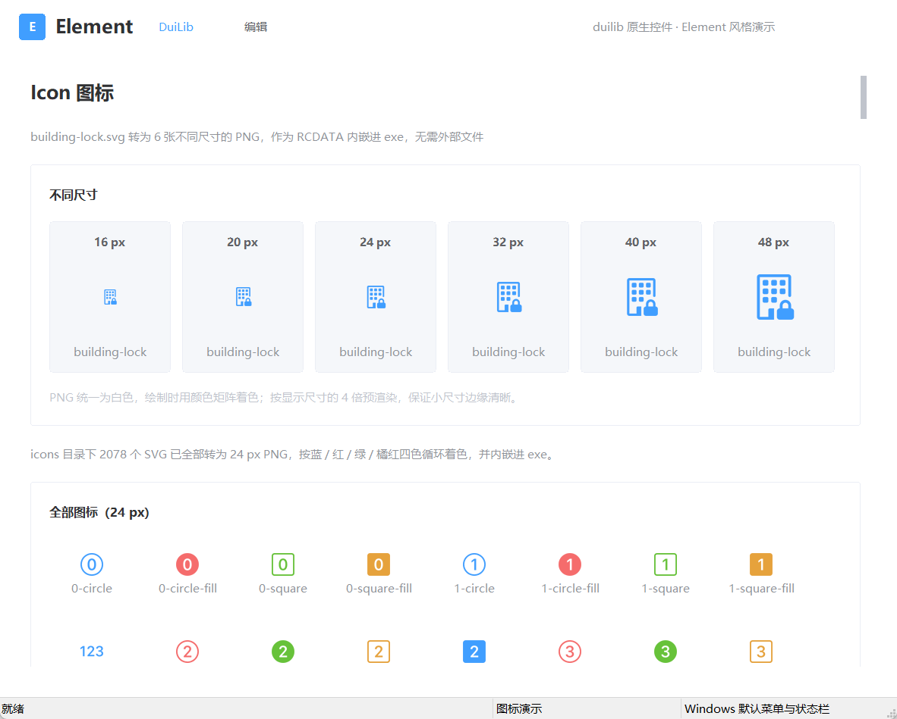

# DuiLibElement

用 [duilib](https://github.com/duilib/duilib) 复刻 [Element UI](https://element.eleme.cn/) 的 Windows 桌面组件演示程序。

在 duilib 原生控件之上，用皮肤属性加轻量子类画出 Element 的视觉与交互，并逐页演示 Element UI 2.x 的组件形态。目的是验证「duilib 到底能多像 Web 组件库」，不是要做一个可复用的 UI 框架。



## 特性

- **单文件可运行**：皮肤 XML、图标 PNG、示例图片全部以 Windows 资源内嵌，exe 运行时不依赖 `res/` 目录
- **三种演示模式**：组件逐页演示（左侧导航 + 内容卡片）、主题预览页复刻、图标预览
- **自绘控件**：`ESelect`、`ECascader`、`ETree`、`EPagination`、`EBadge`、`EAvatar`、`ESteps`、`EBreadcrumb`、`ECollapse`、`EPopover`、`ELoading`、`ERate`、`ESwitch`、`EInputNumber`、`EInfiniteList`、`ELink` 等，均由 duilib 控件派生
- **高 DPI 适配**：启动时读取系统 DPI，由 `UiScale` 统一缩放
- **原生菜单 + 自绘下拉菜单 + 状态栏**：混合 Win32 与 duilib 的典型用法
- **崩溃转储**：未处理异常时在 exe 同目录 `Saved\` 下写 minidump，便于排查

## 截图

主题预览页（按 Element 主题文档的区块等比排版，可交互）：



图标示例：




## 目录结构

```
.
├─ src/                   应用源码
│  ├─ main.cpp            入口：DPI 探测、资源路径、崩溃转储
│  ├─ ElementWindow.*     主窗口、导航、各组件演示页、原生菜单、状态栏
│  ├─ ElementControls.*   自绘控件实现（ESelect、ETree、EBadge 等）
│  ├─ IconCatalog.*       图标资源目录（RCDATA 内嵌）
│  └─ app.rc、Resource.h、UiScale.*
├─ res/                   编译期资源：skin.xml、app.ico、app.manifest、icons/、icons24/
├─ docs/                  文档（Element 组件 × duilib 支持度对照表）
├─ shots/                 演示截图
├─ tools/
│  ├─ svg2png.py          SVG → 多尺寸透明 PNG（headless Chrome/Edge）
│  └─ sync-upstream.ps1   从上游同步 duilib
├─ thirdparty/duilib/     duilib 源码（git subtree 引入，仅 DuiLib/ 参与编译）
├─ CMakeLists.txt         构建脚本
└─ build.bat              一键构建（Windows）
```

`build/`、`bin/`、`dist/` 为构建产物，已被 `.gitignore` 排除。

## 构建

环境要求：

- Windows 10/11 x64
- Visual Studio 2019 或 2022，含「使用 C++ 的桌面开发」工作负载
- CMake ≥ 3.16（VS 自带的也行，`build.bat` 会自动找）

> duilib 的 `UIFlash` / `UIWebBrowser` 控件依赖 ATL 头文件，所以 VS 需要装 ATL 组件（「C++ ATL」）。
> 若本机的 ATL 只装在较新的 VC 工具集上，`build.bat` 会自动挑一个带 ATL 的工具集并通过 `VCToolsVersion` 传给 MSBuild；手动 cmake 构建时如果报 `atlcomcli.h` / `atlctrls.h` 找不到，请安装 ATL 组件或自行指定 `VCToolsVersion`。

一键构建：

```bat
build.bat
```

脚本会定位 vswhere / cmake、按 VS 版本选择生成器、以 x64 配置并编译 Release，最后把 `bin\Release\DuiLibElement.exe`（含 pdb）复制到 `dist\`。

手动构建：

```bat
cmake -S . -B build -G "Visual Studio 17 2022" -A x64
cmake --build build --config Release --parallel
```

说明：duilib 以静态库目标 `duilib_static` 随工程一起编译，源码目录默认是 `thirdparty/duilib/DuiLib`，可用 `-DDUILIB_ROOT=<path>` 指向其它位置的 duilib。

## 运行

双击 `dist\DuiLibElement.exe`，或 `bin\Release\DuiLibElement.exe`。左侧导航切换演示页，顶部「编辑」按钮打开下拉菜单，视图菜单可切换组件／主题／图标三种模式。

## duilib 版本与同步上游

`thirdparty/duilib` 是 [duilib/duilib](https://github.com/duilib/duilib) 的完整快照，通过 **git subtree** 引入，当前基线 commit `85658d4`（master 分支，2012 年前后的版本）。

选 subtree 而不是 submodule，是因为这里既要**直接扩展 duilib 源码**，又要能**周期性把上游改动合入**：subtree 的改动就是本仓库的普通提交，合入上游时也只有一次 squash merge。

**同步上游**

```bat
git subtree pull --prefix=thirdparty/duilib upstream master --squash
```

或使用封装脚本（首次会自动添加 `upstream` remote）：

```powershell
powershell -ExecutionPolicy Bypass -File tools\sync-upstream.ps1
```

**扩展 duilib**

直接在 `thirdparty/duilib/` 下改，和普通代码一样提交。若上游同步时发生冲突，按常规 git 冲突解决；**始终保留 `--squash`**，否则下一次合并的基线会错乱。

**只编译 DuiLib 子目录**

`thirdparty/duilib` 里 `360SafeDemo`、`QQDemo`、`doc`、`bin` 等目录只是随快照存在，不参与构建；本工程只编译 `thirdparty/duilib/DuiLib`。

**向上游回馈补丁**

```bat
git subtree split --prefix=thirdparty/duilib -b duilib-patches
```

会得到一条只含该目录历史的本地分支，可据此向 duilib 提 PR。

## 组件支持度

55 个 Element 视觉组件与 duilib 原生控件的对应关系、实现方式、支持度（已有 / 部分支持 / 需二次开发）见 [docs/Element组件对照表.md](docs/Element组件对照表.md)。

## License

本工程代码采用 MIT 许可，见 [LICENSE](LICENSE)。

`thirdparty/duilib` 版权归 duilib 项目所有，遵循其 MIT 许可，见 `thirdparty/duilib/LICENSE`。
